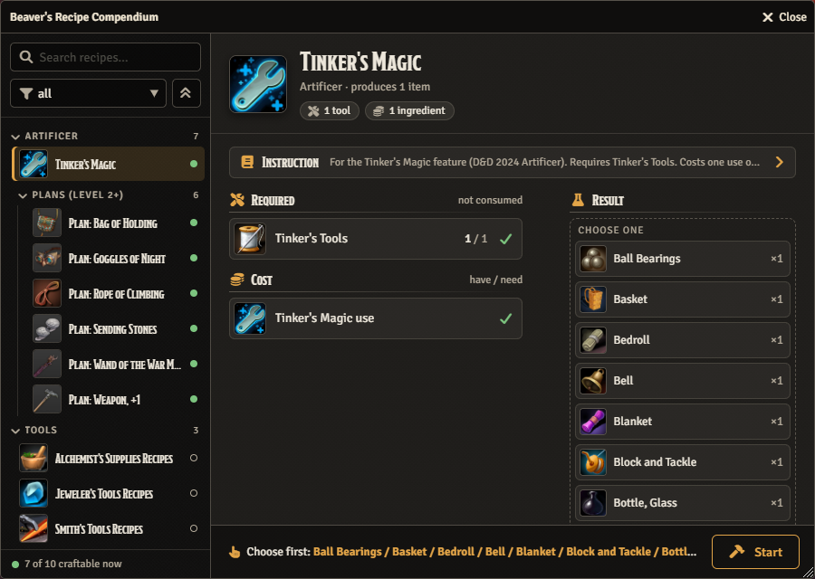
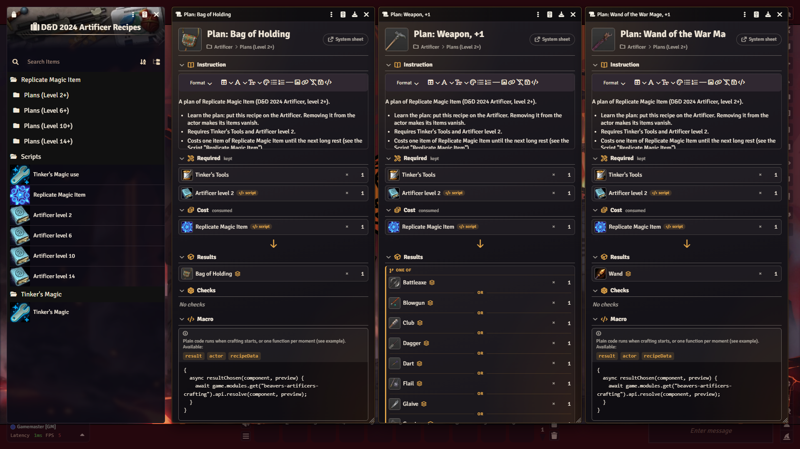

# Beaver's Artificer's Crafting

Artificer recipes for [Beaver's Crafting](https://github.com/AngryBeaver/beavers-crafting), for the dnd5e system (D&D 2024).

Requires Beaver's Crafting 4.13.0 or newer. Keep its setting "Recipes use required Items" on (the default): with it
off, the requirements (Tinker's Tools, Artificer level) are not checked.

## What you need
- **The Artificer**: the D&D 2024 Artificer is not in the SRD 5.2. You need the book with the Artificer and its class
  and features (Tinker's Magic, Replicate Magic Item) on your actors. This module brings only the recipes, not the
  class or its rules.
- **The items**: most plans make items of the SRD 5.2, which dnd5e brings along. With the Dungeon Master's Guide and
  Player's Handbook modules active, their versions are used. The plans of the Artificer's own book (Manifold Tool,
  Repeating Shot, …) make items that are in no free compendium: put those items from your book in a compendium or the
  world, see [Which item you get](#which-item-you-get).

## What you get
The compendium **D&D 2024 Artificer Recipes** with:
- **Tinker's Magic**: one recipe, choose the item you make. Costs a use of the feature, the items are gone after the
  next long rest.
- **Replicate Magic Item**: 56 plans in folders by the Artificer level they need (2, 6, 10, 14). Put a plan on the
  Artificer to learn it. The number of items per long rest and held at once follows the Artificer level, the oldest
  item vanishes, items are attuned when they are made, +1 / +2 plans let you choose the base item.
- **Scripts** that check the requirements and count the uses.
- In the crafting window everything is in the folder "Artificer": Tinker's Magic and the plans by level below it.
- The items come from the Dungeon Master's Guide and Player's Handbook modules when they are active, otherwise from
  the SRD.

The rules themselves are in the book; the recipes only name the features and the items.

## Which item you get
Every result is looked up when it is crafted, by its name and item type:
1. the **Dungeon Master's Guide** and **Player's Handbook** modules, when they are active: they win over the SRD
2. the SRD (`dnd5e.equipment24`)
3. any other Item compendium, then the world's items

Nothing found: the crafting stops with the error that the item is not in the SRD 5.2 and the Dungeon Master needs it
from its book. The plans of the Artificer's own book (Manifold Tool, Repeating Shot, Returning Weapon,
Boots of the Winding Path, Dazzling Weapon, Helm of Awareness, Mind Sharpener, Repulsion Shield, Spell-Refueling Ring)
are in no free compendium: put an item with that name in a compendium or the world.
## Tinker's Magic
- Requires Tinker's Tools.
- Costs one use of Tinker's Magic (Script "Tinker's Magic use"):
  - when the actor's feature "Tinker's Magic" has uses set up, those are used, and dnd5e gives them back on a long rest
  - otherwise this module counts them: Intelligence modifier (at least 1), all back after a long rest
- The results do not stack and are removed after the next long rest.

The feature is found by its identifier `tinkers-magic` or its name "Tinker's Magic".

## Replicate Magic Item
- **Learn a plan**: put its recipe on the Artificer (drag it from the compendium onto the actor).
  It shows in the actor's crafting list. **Remove the recipe** from the actor: the items made with it vanish.
- Requires Tinker's Tools and the Artificer level of the plan (Script "Artificer level 2/6/10/14").
  The level is that of the actor's class with the identifier `artificer` (or named "Artificer").
- Costs one item of Replicate Magic Item (Script "Replicate Magic Item"): as many per long rest as the "Magic Items"
  column allows (2 at level 2, 3 at 6, 4 at 10, 5 at 14, 6 at 18), each from a different plan.
- You can't have more items than that: when a new one is made, the oldest one vanishes.
- Items that need attunement are attuned when they are made.
- **+1 / +2 plans** (Weapon, Armor, Shield, Wand of the War Mage): choose the base item, it gets dnd5e's magic bonus
  (and for the Wand of the War Mage the spell attack bonus) when it is made.
  Wraps of Unarmed Power: the Dungeon Master's Guide item; use its enchantment on your Unarmed Strike.
- **Common Magic Item, Uncommon / Rare Wondrous Item**: one recipe with every such item as a choice. You learn these
  plans one item at a time: copy the recipe and keep the result you learned.
- Not counted: what happens when you die (the items vanish after 1d4 days).

## License
The code is MIT licensed (see LICENSE).

The items used are from the System Reference Document 5.2 ("SRD 5.2") by Wizards of the Coast LLC,
available at https://www.dndbeyond.com/srd, licensed under the
[Creative Commons Attribution 4.0 International License](https://creativecommons.org/licenses/by/4.0/legalcode).

The compendium links to items and icons of the Dungeon Master's Guide and Player's Handbook modules by their ids and
paths; none of their content is part of this module. Without those modules the SRD items are used.
